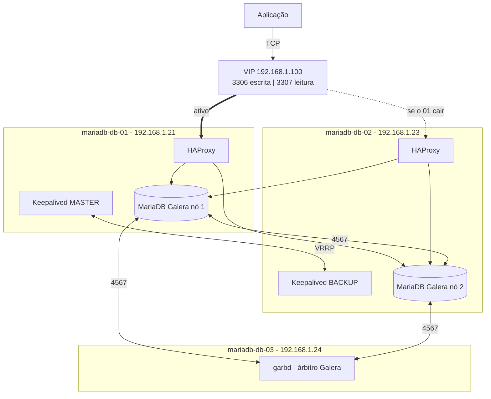

# MariaDB Galera HA: 2 nós + árbitro + HAProxy + Keepalived

Cluster MariaDB Galera com 2 nós de dados e 1 árbitro (garbd), com HAProxy e Keepalived para entregar um IP virtual (VIP) único para a aplicação.

Procedimento validado em laboratório (VirtualBox). Siga na ordem.

## Topologia



O árbitro não guarda dados. Ele só vota, para o cluster manter quórum (maioria) com 2 nós.

## Servidores

| Host | IP | Função |
|---|---|---|
| mariadb-db-01 | 192.168.1.21 | MariaDB Galera, HAProxy, Keepalived (MASTER) |
| mariadb-db-02 | 192.168.1.23 | MariaDB Galera, HAProxy, Keepalived (BACKUP) |
| mariadb-db-03 | 192.168.1.24 | garbd (árbitro) |
| VIP | 192.168.1.100 | IP virtual, não é uma VM |

## Versões usadas

| Item | Versão |
|---|---|
| Ubuntu | 26.04.1 LTS (resolute) |
| MariaDB Server | 12.3.3 (`1:12.3.3+maria~ubu2604`), repositório `deb.mariadb.org/12.3/ubuntu` |
| galera-4 (provider) | 26.4.27-ubu2604 |
| galera-arbitrator-4 (garbd) | 26.4.27-ubu2604 |
| mariadb-backup | 1:12.3.3+maria~ubu2604 |
| mariadb-server-galera | 1:12.3.3+maria~ubu2604 |
| socat | 1.8.1.1-1ubuntu0.1 |
| HAProxy | pacote `haproxy` do Ubuntu 26.04 (consulte com `haproxy -v`) |
| Keepalived | pacote `keepalived` do Ubuntu 26.04 (consulte com `keepalived --version`) |

O garbd e o galera-4 precisam estar na mesma versão.

## Pré-requisitos

- 3 VMs Ubuntu 26.04.1 LTS com MariaDB 12.3.3 instalado do repositório oficial da MariaDB.
- IP fixo e hostname próprio em cada VM.
- Duas placas de rede por VM no VirtualBox: NAT (`enp0s3`, 10.0.2.15) e rede do laboratório (`enp0s8`, 192.168.1.x). O cluster e o VIP usam a `enp0s8`.
- VMs clonadas precisam de `machine-id` diferente. Confira nas 3: `cat /etc/machine-id`.
- O IP 192.168.1.100 precisa estar livre. Teste: `ping -c 2 192.168.1.100` não pode responder.
- Acesso `sudo` nas 3 VMs.

Portas, só se o `ufw` estiver ativo:

| Porta | Uso | Servidores |
|---|---|---|
| 3306/tcp | MariaDB e VIP escrita | 01, 02 |
| 3307/tcp | VIP leitura | 01, 02 |
| 4567/tcp e udp | Galera | 01, 02, 03 |
| 4568/tcp | Galera IST | 01, 02 |
| 4444/tcp | Galera SST | 01, 02 |
| 9200/tcp | Health check | 01, 02 |
| 8404/tcp | Estatísticas do HAProxy | 01, 02 |
| protocolo VRRP (112) | Keepalived | 01, 02 |

## Passo 1: desligar atualização automática (01, 02 e 03)

Evita que o apt trave e que pacotes do Galera sejam atualizados sozinhos.

```bash
sudo systemctl disable --now unattended-upgrades apt-daily.timer apt-daily-upgrade.timer
```

## Passo 2: instalar pacotes

**No 01 e no 02:**

```bash
sudo apt update
sudo apt -o DPkg::Lock::Timeout=300 install galera-4 mariadb-backup socat mariadb-server-galera
```

Confira:

```bash
ls -l /usr/lib/galera/libgalera_smm.so /usr/bin/wsrep_sst_mariabackup /usr/bin/galera_new_cluster
dpkg -l | grep -E 'galera-4|mariadb-backup|mariadb-server-galera|socat'
```

Atenção:

- O `mariadb-server-galera` traz os scripts de SST e o `galera_new_cluster`. Sem ele o cluster não sobe.
- Instalar esse pacote reinicia o MariaDB. Por isso ele é instalado antes de configurar o Galera.
- Se o apt perguntar sobre o arquivo `60-galera.cnf`, responda `N` (manter o atual).

**No 03:**

```bash
sudo apt -o DPkg::Lock::Timeout=300 install galera-arbitrator-4
apt-cache policy galera-arbitrator-4
```

O 03 não precisa do MariaDB em execução. Se estiver instalado, desabilite:

```bash
sudo systemctl disable --now mariadb
```

## Passo 3: configurar o Galera (01 e 02)

Troque `SENHA_SST` por uma senha sua. Ela precisa ser igual nos dois nós e no Passo 5.

**No mariadb-db-01:**

```bash
sudo tee /etc/mysql/mariadb.conf.d/60-galera.cnf > /dev/null <<'EOF'
[mysqld]
bind-address                   = 192.168.1.21
binlog_format                  = ROW
default_storage_engine         = InnoDB
innodb_autoinc_lock_mode       = 2
innodb_flush_log_at_trx_commit = 1

[galera]
wsrep_on                       = ON
wsrep_provider                 = /usr/lib/galera/libgalera_smm.so
wsrep_cluster_name             = mariadb_lab_cluster
wsrep_cluster_address          = gcomm://192.168.1.21,192.168.1.23
wsrep_node_name                = mariadb-db-01
wsrep_node_address             = 192.168.1.21
wsrep_sst_method               = mariabackup
wsrep_sst_auth                 = sst_user:SENHA_SST
wsrep_slave_threads            = 4
wsrep_provider_options         = "gcache.size=512M"
EOF
```

**No mariadb-db-02:**

```bash
sudo tee /etc/mysql/mariadb.conf.d/60-galera.cnf > /dev/null <<'EOF'
[mysqld]
bind-address                   = 192.168.1.23
binlog_format                  = ROW
default_storage_engine         = InnoDB
innodb_autoinc_lock_mode       = 2
innodb_flush_log_at_trx_commit = 1

[galera]
wsrep_on                       = ON
wsrep_provider                 = /usr/lib/galera/libgalera_smm.so
wsrep_cluster_name             = mariadb_lab_cluster
wsrep_cluster_address          = gcomm://192.168.1.21,192.168.1.23
wsrep_node_name                = mariadb-db-02
wsrep_node_address             = 192.168.1.23
wsrep_sst_method               = mariabackup
wsrep_sst_auth                 = sst_user:SENHA_SST
wsrep_slave_threads            = 4
wsrep_provider_options         = "gcache.size=512M"
EOF
```

Notas:

- O `bind-address` é o IP do próprio nó. O HAProxy usa o VIP na porta 3306 na mesma máquina, então o MariaDB não pode escutar em `0.0.0.0`.
- Na 12.3 a variável é `wsrep_slave_threads`. O nome `wsrep_applier_threads` não existe e impede o MariaDB de subir.

Valide a configuração nos dois nós. Sem nenhuma saída, está certo:

```bash
mariadbd --help --verbose 2>&1 | grep -i 'unknown variable'
```

Pare o MariaDB nos dois nós:

```bash
sudo systemctl stop mariadb
pgrep -a mariadbd
```

O `pgrep` não pode listar nada.

## Passo 4: iniciar o cluster no 01

**Somente no 01.** Se existir `/var/lib/mysql/grastate.dat`, ele precisa ter `safe_to_bootstrap: 1`.

```bash
sudo cat /var/lib/mysql/grastate.dat
sudo galera_new_cluster
sudo mariadb -e "SHOW STATUS WHERE Variable_name IN ('wsrep_cluster_size','wsrep_ready','wsrep_local_state_comment');"
```

Resultado esperado: `wsrep_cluster_size = 1`, `wsrep_ready = ON`, `Synced`.

## Passo 5: usuário de SST e entrada do 02

**No 01**, crie o usuário que o 02 usa para copiar os dados. Use a mesma senha do `wsrep_sst_auth`.

```bash
sudo mariadb <<'EOF'
CREATE USER 'sst_user'@'localhost' IDENTIFIED BY 'SENHA_SST';
GRANT RELOAD, PROCESS, LOCK TABLES, BINLOG MONITOR, REPLICATION CLIENT ON *.* TO 'sst_user'@'localhost';
FLUSH PRIVILEGES;
EOF
```

**No 02**, inicie o MariaDB. Ele copia os dados do 01 (SST) e apaga os dados locais dele.

```bash
sudo systemctl start mariadb
```

Valide em qualquer nó:

```bash
sudo mariadb -e "SHOW STATUS WHERE Variable_name IN ('wsrep_cluster_size','wsrep_cluster_status','wsrep_local_state_comment');"
```

Resultado esperado: `wsrep_cluster_size = 2`, `Primary`, `Synced`.

## Passo 6: árbitro (03)

```bash
sudo tee /etc/default/garb > /dev/null <<'EOF'
GALERA_NODES="192.168.1.21:4567 192.168.1.23:4567"
GALERA_GROUP="mariadb_lab_cluster"
EOF

sudo systemctl enable --now garb
sudo systemctl status garb --no-pager | head -n 5
```

Não use `LOG_FILE` neste arquivo. O garbd não tem permissão para criar o log em `/var/log` e o serviço falha. Os logs ficam em `journalctl -u garb`.

O `GALERA_GROUP` precisa ser igual ao `wsrep_cluster_name`.

Valide em qualquer nó (01 ou 02):

```bash
sudo mariadb -e "SHOW STATUS WHERE Variable_name IN ('wsrep_cluster_size','wsrep_cluster_status');"
```

Resultado esperado: `wsrep_cluster_size = 3` (o árbitro conta como membro) e `Primary`.

### Teste de replicação (opcional)

No 01:

```bash
sudo mariadb -e "CREATE DATABASE teste_galera; CREATE TABLE teste_galera.t (id INT PRIMARY KEY AUTO_INCREMENT, origem VARCHAR(30)); INSERT INTO teste_galera.t (origem) VALUES ('db-01');"
```

No 02:

```bash
sudo mariadb -e "SELECT * FROM teste_galera.t; INSERT INTO teste_galera.t (origem) VALUES ('db-02');"
```

No 01 devem aparecer as duas linhas. Para limpar:

```bash
sudo mariadb -e "DROP DATABASE teste_galera;"
```

## Passo 7: health check na porta 9200 (01 e 02)

O HAProxy consulta esta porta. Ela responde 200 só quando o nó está `Synced`.

```bash
sudo tee /usr/local/bin/galera-check.sh > /dev/null <<'EOF'
#!/bin/bash
# Responde HTTP 200 se o nó está Synced (wsrep_local_state = 4), 503 caso contrário.
# Consome a requisição inteira (até a linha em branco) para evitar RST no cliente.
while IFS= read -r -t 2 line; do
  line=${line%$'\r'}
  [ -z "$line" ] && break
done
STATE=$(mariadb -N -s -e "SHOW GLOBAL STATUS LIKE 'wsrep_local_state'" 2>/dev/null | awk '{print $2}')
if [ "$STATE" = "4" ]; then
  CODE="200 OK";                  BODY="Galera Synced"
else
  CODE="503 Service Unavailable"; BODY="Galera Not Synced"
fi
LEN=$(( ${#BODY} + 1 ))
printf 'HTTP/1.1 %s\r\nContent-Type: text/plain\r\nConnection: close\r\nContent-Length: %d\r\n\r\n%s\n' "$CODE" "$LEN" "$BODY"
EOF
sudo chmod 755 /usr/local/bin/galera-check.sh

sudo tee /etc/systemd/system/galera-check.socket > /dev/null <<'EOF'
[Unit]
Description=Galera health check (HTTP 9200)

[Socket]
ListenStream=9200
Accept=yes

[Install]
WantedBy=sockets.target
EOF

sudo tee /etc/systemd/system/galera-check@.service > /dev/null <<'EOF'
[Unit]
Description=Galera health check handler

[Service]
ExecStart=/usr/local/bin/galera-check.sh
StandardInput=socket
StandardOutput=socket
EOF

sudo systemctl daemon-reload
sudo systemctl enable --now galera-check.socket
```

Teste (resultado esperado: `HTTP/1.1 200 OK` e `Galera Synced`):

```bash
curl -i http://127.0.0.1:9200
```

No 01 teste o 02 e no 02 teste o 01:

```bash
curl -i http://192.168.1.23:9200    # rodar no 01
curl -i http://192.168.1.21:9200    # rodar no 02
```

O script lê a requisição inteira antes de responder. Se ele ler só a primeira linha, o HAProxy recebe `ECONNRESET` e marca todos os nós como DOWN, mesmo com o `curl` funcionando.

O script roda como root e usa o `unix_socket` do root do MariaDB, sem senha.

## Passo 8: HAProxy (01 e 02)

```bash
sudo apt -o DPkg::Lock::Timeout=300 install haproxy
echo 'net.ipv4.ip_nonlocal_bind = 1' | sudo tee /etc/sysctl.d/99-haproxy.conf
sudo sysctl --system | grep nonlocal
haproxy -v | head -n 1
```

O `ip_nonlocal_bind` deixa o HAProxy escutar no VIP mesmo quando o VIP está no outro nó.

Confira que o MariaDB escuta só no IP do nó (e não em `0.0.0.0:3306`):

```bash
sudo ss -ltnp | grep -E ':3306|:3307|:8404'
```

Arquivo idêntico nos dois nós:

```bash
sudo tee /etc/haproxy/haproxy.cfg > /dev/null <<'EOF'
global
    log /dev/log local0
    maxconn 4096

defaults
    log     global
    mode    tcp
    option  tcplog
    option  dontlognull
    retries 3
    timeout connect 5s
    timeout client  1h
    timeout server  1h

# Escrita: um nó ativo, o outro só assume se o ativo cair
listen mariadb_write
    bind 192.168.1.100:3306
    option httpchk GET /
    http-check expect status 200
    balance leastconn
    default-server inter 2s fall 3 rise 2 on-marked-down shutdown-sessions
    server mariadb-db-01 192.168.1.21:3306 check port 9200
    server mariadb-db-02 192.168.1.23:3306 check port 9200 backup

# Leitura: balanceada entre os dois nós
listen mariadb_read
    bind 192.168.1.100:3307
    option httpchk GET /
    http-check expect status 200
    balance leastconn
    default-server inter 2s fall 3 rise 2 on-marked-down shutdown-sessions
    server mariadb-db-01 192.168.1.21:3306 check port 9200
    server mariadb-db-02 192.168.1.23:3306 check port 9200

listen stats
    mode http
    bind *:8404
    stats enable
    stats uri /stats
    stats refresh 5s
EOF

sudo haproxy -c -f /etc/haproxy/haproxy.cfg
sudo systemctl enable haproxy
sudo systemctl restart haproxy
```

Aguarde cerca de 15 segundos e valide:

```bash
curl -s 'http://127.0.0.1:8404/stats;csv' | cut -d, -f1,2,18,37,38 | column -s, -t
```

Resultado esperado: `mariadb-db-01` e `mariadb-db-02` em `UP`, com `L7OK` e `200`, em `mariadb_write` e `mariadb_read`. Se algum aparecer com `L7TOUT` logo após o restart, espere mais alguns segundos.

## Passo 9: Keepalived e VIP (01 e 02)

```bash
sudo apt -o DPkg::Lock::Timeout=300 install keepalived
sudo useradd -r -s /usr/sbin/nologin keepalived_script
keepalived --version | head -n 1
```

Se o `useradd` disser que o usuário já existe, ignore.

A interface é detectada pelo IP do nó. Confira o que o `echo` imprime. Deve ser `enp0s8`.

A senha VRRP (`auth_pass`) usa no máximo 8 caracteres. Troque `Galera01` se quiser, mantendo o limite e o mesmo valor nos dois nós.

**No mariadb-db-01:**

```bash
IFACE=$(ip -br a | awk '/192\.168\.1\.21\//{print $1}')
echo "Interface detectada: $IFACE"

sudo tee /etc/keepalived/keepalived.conf > /dev/null <<EOF
global_defs {
    enable_script_security
    script_user keepalived_script
}

vrrp_script chk_haproxy {
    script "/usr/bin/pidof haproxy"
    interval 2
    fall 2
    rise 2
    weight -20
}

vrrp_instance VI_MARIADB {
    state MASTER
    interface $IFACE
    virtual_router_id 51
    priority 110
    advert_int 1
    unicast_src_ip 192.168.1.21
    unicast_peer {
        192.168.1.23
    }
    authentication {
        auth_type PASS
        auth_pass Galera01
    }
    virtual_ipaddress {
        192.168.1.100/24 dev $IFACE
    }
    track_script {
        chk_haproxy
    }
}
EOF
```

**No mariadb-db-02:**

```bash
IFACE=$(ip -br a | awk '/192\.168\.1\.23\//{print $1}')
echo "Interface detectada: $IFACE"

sudo tee /etc/keepalived/keepalived.conf > /dev/null <<EOF
global_defs {
    enable_script_security
    script_user keepalived_script
}

vrrp_script chk_haproxy {
    script "/usr/bin/pidof haproxy"
    interval 2
    fall 2
    rise 2
    weight -20
}

vrrp_instance VI_MARIADB {
    state BACKUP
    interface $IFACE
    virtual_router_id 51
    priority 100
    advert_int 1
    unicast_src_ip 192.168.1.23
    unicast_peer {
        192.168.1.21
    }
    authentication {
        auth_type PASS
        auth_pass Galera01
    }
    virtual_ipaddress {
        192.168.1.100/24 dev $IFACE
    }
    track_script {
        chk_haproxy
    }
}
EOF
```

Suba o serviço, primeiro no 01, depois no 02:

```bash
sudo systemctl enable --now keepalived
```

Valide, nos dois nós:

```bash
ip -br a show enp0s8 | grep 192.168.1.100
```

O VIP deve aparecer só no 01. No 02 o comando não imprime nada.

Valide a partir do 03:

```bash
ping -c 3 192.168.1.100
curl -s -o /dev/null -w '%{http_code}\n' http://192.168.1.100:8404/stats
```

Resultado esperado: o `ping` responde e o `curl` retorna `200`.

## Passo 10: usuário da aplicação e teste pelo VIP

**No 01** (replica para o 02 sozinho). Troque `SENHA_APP`.

```bash
sudo mariadb <<'EOF'
CREATE DATABASE IF NOT EXISTS teste_ha;
CREATE TABLE IF NOT EXISTS teste_ha.t (id INT PRIMARY KEY AUTO_INCREMENT, origem VARCHAR(30), ts TIMESTAMP DEFAULT CURRENT_TIMESTAMP) ENGINE=InnoDB;
CREATE USER 'app'@'192.168.1.%' IDENTIFIED BY 'SENHA_APP';
GRANT ALL PRIVILEGES ON teste_ha.* TO 'app'@'192.168.1.%';
FLUSH PRIVILEGES;
EOF
```

O host `192.168.1.%` é necessário. Pelo HAProxy, o MariaDB vê a conexão vindo do IP do nó do HAProxy, não do IP do cliente.

**No 03**, conecte pelo VIP:

```bash
export MYSQL_PWD='SENHA_APP'

echo "== 3306 escrita: todas devem ser mariadb-db-01 =="
for i in $(seq 1 5); do
  mariadb -h 192.168.1.100 -P 3306 -u app -N -e "SELECT @@hostname;" 2>/dev/null
done

echo "== 3307 leitura: deve misturar os dois nós =="
for i in $(seq 1 6); do
  mariadb -h 192.168.1.100 -P 3307 -u app -N -e "SELECT @@hostname, SLEEP(2);" 2>/dev/null &
done; wait

mariadb -h 192.168.1.100 -P 3306 -u app -e "INSERT INTO teste_ha.t (origem) VALUES ('via-vip'); SELECT * FROM teste_ha.t;" 2>/dev/null
unset MYSQL_PWD
```

No 02, confirme que a linha chegou:

```bash
sudo mariadb -e "SELECT * FROM teste_ha.t;"
```

Na leitura (3307) são usadas conexões simultâneas com `SLEEP`. O `leastconn` escolhe o servidor com menos conexões ativas, então conexões rápidas em sequência podem cair sempre no mesmo nó.

## Desligar e ligar o ambiente

Este procedimento é o padrão do Galera e não foi testado neste laboratório.

**Desligar** (sempre desligamento normal, nunca "desligar a máquina" no VirtualBox):

1. No 03: `sudo systemctl stop garb && sudo shutdown -h now`
2. No 02: `sudo systemctl stop mariadb && sudo shutdown -h now`
3. No 01 (último): 

```bash
sudo systemctl stop mariadb
sudo cat /var/lib/mysql/grastate.dat
sudo shutdown -h now
```

No 01, o `grastate.dat` deve mostrar `safe_to_bootstrap: 1`.

**Ligar** (ordem inversa): 01, depois 02, depois 03.

Quando o 01 terminar de ligar, o MariaDB dele não forma o cluster sozinho. Inicie o cluster manualmente:

```bash
sudo systemctl stop mariadb
sudo systemctl reset-failed mariadb
sudo grep safe_to_bootstrap /var/lib/mysql/grastate.dat
sudo galera_new_cluster
```

Depois ligue o 02 (o MariaDB entra sozinho no cluster) e o 03 (o `garb` sobe sozinho).

Todo o resto sobe sozinho: HAProxy, Keepalived, `galera-check.socket` e `ip_nonlocal_bind`.

**Validar depois de ligar**, nos nós 01 e 02:

```bash
sudo mariadb -e "SHOW STATUS WHERE Variable_name IN ('wsrep_cluster_size','wsrep_cluster_status','wsrep_local_state_comment','wsrep_ready');"
systemctl is-active mariadb haproxy keepalived galera-check.socket
ip -br a show enp0s8 | grep 192.168.1.100
curl -s 'http://127.0.0.1:8404/stats;csv' | cut -d, -f1,2,18,37,38 | column -s, -t
```

No 03:

```bash
systemctl is-active garb
```

Resultado esperado: `wsrep_cluster_size = 3`, `Primary`, `Synced`, `ready = ON`, serviços `active`, VIP no 01 e os quatro servidores do HAProxy em `UP` com `L7OK`.

## Observações

- **Logs do MariaDB:** ficam no `journalctl -u mariadb`. O arquivo `/var/log/mysql/error.log` não existe.
- **IDs automáticos:** o Galera define `auto_increment_increment = 3` (o árbitro conta como membro) e distribui o `auto_increment_offset` entre os nós. Os valores mudam quando o cluster muda. Os IDs não colidem, mas não dependa do padrão.
- **`wsrep_incoming_addresses`:** mostra `192.168.1.21:0,192.168.1.23:0,`. A porta `0` e a vírgula final são normais neste cenário.
- **Aviso do cliente:** `--ssl-verify-server-cert is disabled, because of an insecure passwordless login` aparece ao usar `MYSQL_PWD`. Não afeta o resultado.
- **Atualizações:** em produção, atualize um nó por vez, de forma controlada. Neste laboratório as atualizações automáticas foram desligadas no Passo 1.
- **Health check:** testar só com `curl` não basta. Valide sempre pelo HAProxy (`stats;csv`).

## Comandos úteis

```bash
# Estado do cluster
sudo mariadb -e "SHOW STATUS LIKE 'wsrep_%';" | grep -E 'cluster_size|cluster_status|local_state_comment|ready|connected'

# Logs
sudo journalctl -u mariadb -n 50 --no-pager
sudo journalctl -u haproxy -n 50 --no-pager
sudo journalctl -u keepalived -n 50 --no-pager
sudo journalctl -u garb -n 50 --no-pager

# Onde está o VIP
ip -br a show enp0s8 | grep 192.168.1.100
```

## Não incluído neste documento

- Testes de falha (parar nó, parar HAProxy, desligar árbitro).
- Recuperação de cluster (perda de quórum, queda total).
- ClusterControl.
